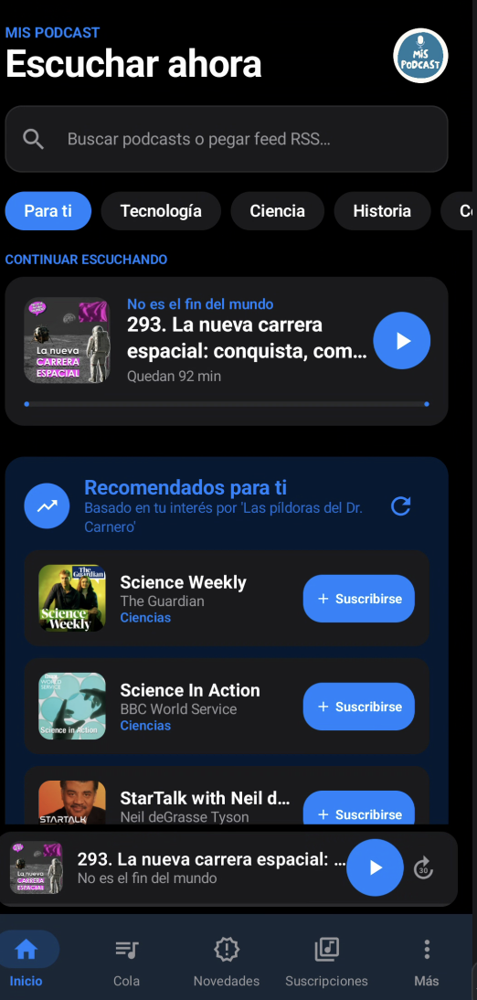
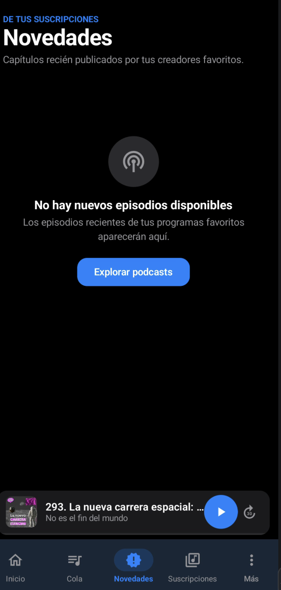
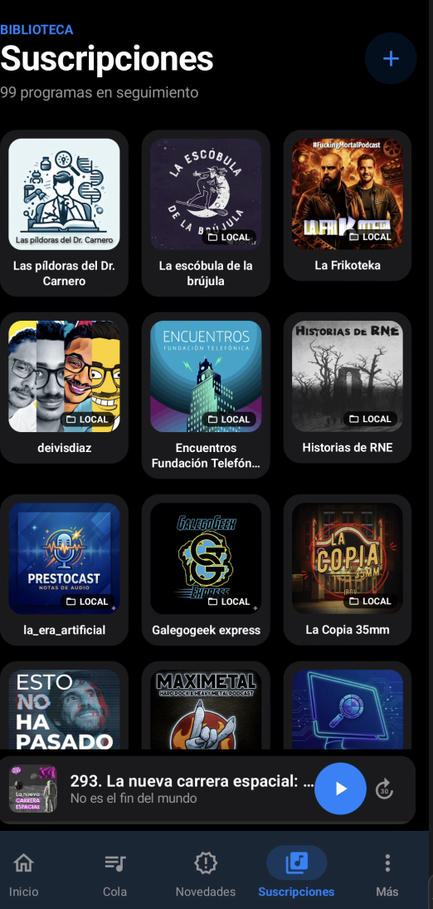
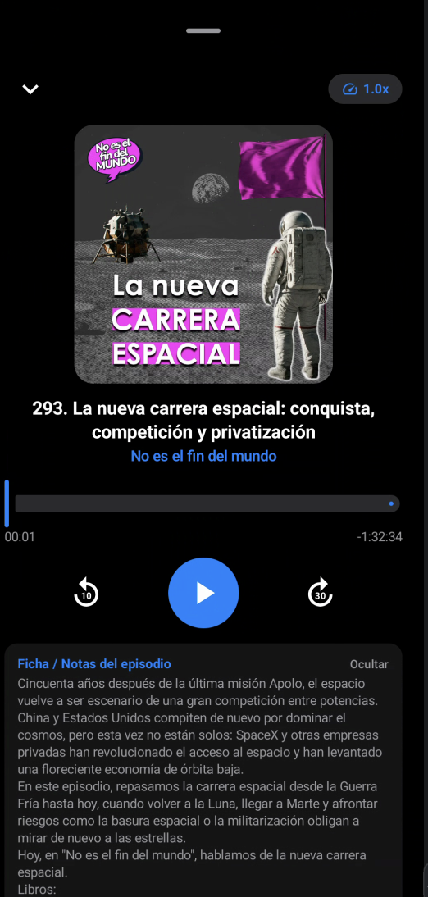
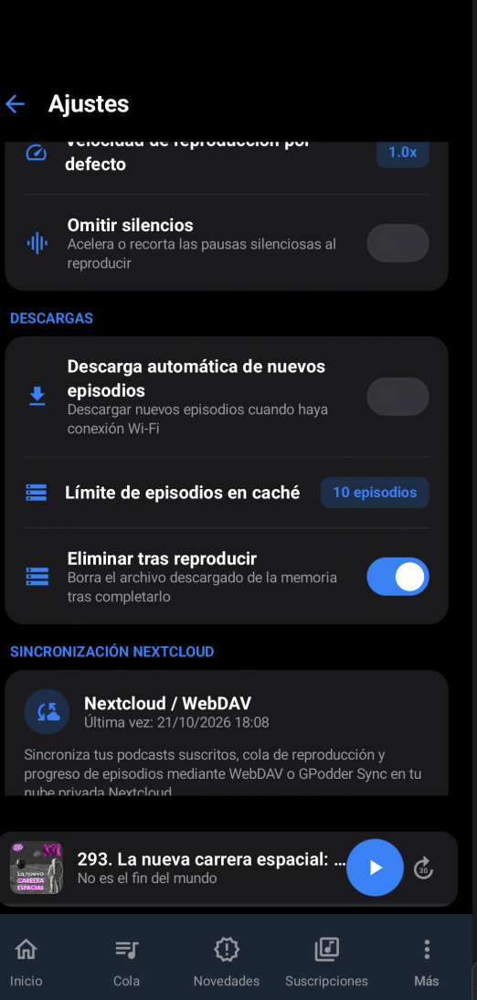

<div align="center">

  

  # Mis Podcast

  **El gestor y reproductor de podcasts moderno, libre y privado para Android.**  
  *Inspirado en el diseño fluido y limpio de Apple Podcasts con toda la potencia del Software Libre.*

  [](https://www.gnu.org/licenses/gpl-3.0)
  [-green.svg)](https://android.com)
  [](https://kotlinlang.org)
  [-4285F4.svg)](https://developer.android.com/jetpack/compose)
  [](https://android.com/auto)
  [](https://nextcloud.com)

</div>

---

## 📖 Índice

- [Acerca del Proyecto](#-acerca-del-proyecto)
- [Características Principales](#-características-principales)
- [Recorrido Visual (Capturas de Pantalla)](#-recorrido-visual-capturas-de-pantalla)
  - [1. Inicio y Exploración](#1-inicio-y-exploración)
  - [2. Recomendaciones por Categorías](#2-recomendaciones-por-categorías)
  - [3. Novedades](#3-novedades)
  - [4. Suscripciones y Carpetas Locales](#4-suscripciones-y-carpetas-locales)
  - [5. Cola de Reproducción Inteligente](#5-cola-de-reproducción-inteligente)
  - [6. Reproductor de Audio](#6-reproductor-de-audio)
  - [7. Ajustes y Sincronización](#7-ajustes-y-sincronización)
- [Sincronización en la Nube con Nextcloud](#-sincronización-en-la-nube-con-nextcloud)
- [Compatibilidad con Android Auto](#-compatibilidad-con-android-auto)
- [Compatibilidad con AntennaPod y OPML](#-compatibilidad-con-antennapod-y-opml)
- [Arquitectura y Tecnologías](#-arquitectura-y-tecnologías)
- [Compilación e Instalación](#-compilación-e-instalación)
- [Autor](#-autor)
- [Licencia](#-licencia)

---

## 🎙 Acerca del Proyecto

**Mis Podcast** es una aplicación nativa para Android desarrollada con las tecnologías más modernas (Kotlin, Jetpack Compose y Material 3). Ha sido diseñada para ofrecer una experiencia auditiva premium, elegante y libre de distracciones:

- **Sin anuncios invasivos ni seguimiento:** Tu privacidad es sagrada. No existen rastreadores de terceros ni telemetría oculta.
- **Podcasting 2.0:** Soporte para transcripciones, capítulos enriquecidos, fuentes de financiación y créditos.
- **Sincronización en la nube propia:** Mantén sincronizados tus puntos de escucha, favoritos, suscripciones y cola con tu propio servidor **Nextcloud** mediante WebDAV o GPodder.
- **Soporte completo para audios locales:** Escucha carpetas locales de audio mediante Storage Access Framework (SAF) con carátulas automáticas y re-escaneo inteligente.
- **Android Auto integrado:** Navega por tu cola, historial, descargas y suscripciones de manera segura mientras conduces.

---

## ✨ Características Principales

- **Descubrimiento y Tendencias en Español:** Integración fluida con el catálogo de Apple Podcasts para explorar listas de éxitos y podcasts populares por categorías (Tecnología, Historia, Noticias, Ciencia, Comedia, etc.).
- **Reproductor de Alto Rendimiento:** Basado en `AndroidX Media3` y `ExoPlayer`, con control de velocidad (1.0x, 1.25x, 1.5x, 2.0x), saltos inteligentes configurables (avance y retroceso) y persistencia exacta del punto de escucha.
- **Gestión Avanzada de Novedades:** Registro limpio que muestra únicamente los episodios estrenados *después* de suscribirte a un podcast, evitando saturar tu bandeja con cientos de episodios antiguos.
- **Cola de Reproducción Permanente:** Con reordenación manual y ordenación automática inteligente por duración, tamaño, fecha o título, manteniendo siempre el episodio en reproducción activo.
- **Descargas Offline:** Descarga automática y manual de episodios con límites de caché para escuchar sin conexión en cualquier momento.
- **Migración Universal:** Importador completo de bases de datos de **AntennaPod** (`.db` y `.zip`) y listas **OPML** con reconexión de carpetas locales.

---

## 📱 Recorrido Visual (Capturas de Pantalla)

A continuación se detallan las secciones de la aplicación junto a sus capturas de pantalla correspondientes:

### 1. Inicio y Exploración
> Vista principal con diseño estilo Apple Podcasts, carrusel de tendencias, destacados y buscador instantáneo de programas y creadores.

<div align="center">
  
</div>

---

### 2. Recomendaciones por Categorías
> Explorador temático por géneros (Tecnología, Historia, Noticias, Sociedad, Salud, etc.) con carga dinámica y cambio de región/idioma.

<div align="center">
  
</div>

---

### 3. Novedades
> Feed cronológico de los nuevos capítulos publicados por tus programas seguidos desde el momento de tu suscripción, con insignia de nuevos episodios y limpieza completa en un toque.

<div align="center">
  
</div>

---

### 4. Suscripciones y Carpetas Locales
> Catálogo completo de tus podcasts suscritos en cuadrícula moderna, identificando claramente con insignias `LOCAL` las carpetas físicas de tu dispositivo y permitiendo su reconexión o re-escaneo SAF.

<div align="center">
  
</div>

---

### 5. Cola de Reproducción Inteligente
> Lista organizada de reproducción donde puedes reorganizar episodios al vuelo o aplicar criterios automáticos (duración ascendente/descendente, tamaño de archivo, fecha o título).

<div align="center">
  
</div>

---

### 6. Reproductor de Audio
> Reproductor a pantalla completa y mini-player persistente con carátulas en alta resolución, salto configurable (10s/30s), selector de velocidad y barra de progreso fluida.

<div align="center">
  
</div>

---

### 7. Ajustes y Sincronización
> Panel de control con temas (Claro, Oscuro, Amoled o Sistema), frecuencias de comprobación periódica en segundo plano, gestión de almacenamiento, copias de seguridad e integración con Nextcloud.

<div align="center">
  
</div>

---

## ☁️ Sincronización en la Nube con Nextcloud

**Mis Podcast** incluye un motor de sincronización liviano basado en WebDAV diseñado para sincronizar:
- Suscripciones a podcasts (añadidos, bajas y carpetas locales).
- Puntos de escucha exactos (`currentPositionMs`) y capítulos marcados como reproducidos.
- Cola de reproducción activa y su orden.
- Episodios favoritos e historial de escucha acumulado.
- Estadísticas de horas reproducidas.

### Funcionamiento Liviano
- **Cero consumo si no está configurado:** Comprobación instantánea en memoria sin consumo de batería ni peticiones innecesarias.
- **Debounce y Coalescencia:** Las acciones continuadas (como pausar, reanudar o suscribirse a varios podcasts) se agrupan en una única petición al cabo de 2-3 segundos.
- **Protección Mutex:** Garantiza que no se produzcan llamadas WebDAV paralelas que puedan sobrecargar el servidor o crear condiciones de carrera.

---

## 🚗 Compatibilidad con Android Auto

La aplicación implementa de forma nativa `MediaLibraryService` (`AndroidX Media3`), ofreciendo una interfaz adaptada a pantallas de vehículos:
- **Cola de Reproducción:** Acceso directo a los episodios listos para escuchar.
- **Novedades:** Últimas emisiones disponibles en un solo toque.
- **Suscripciones y Descargas:** Reproduce tus archivos descargados incluso en zonas sin cobertura móvil.
- **Controles táctiles y físicos:** Compatible con mandos en el volante y diales giratorios.

---

## 📦 Compatibilidad con AntennaPod y OPML

Si provienes de **AntennaPod** o cualquier otro reproductor:
- **Importación de Bases de Datos SQLite (.db o .zip):** Recupera tus suscripciones, historial de capítulos escuchados, episodios favoritos, cola y estadísticas completas.
- **Carpetas Locales Reconectables:** Las carpetas locales importadas desde AntennaPod se reconocen automáticamente y se pueden reconectar a cualquier ruta del almacenamiento con permisos persistentes SAF y detección automática de carátulas (`cover.jpg`, `images.png`, etc.).
- **Listas OPML:** Exporta e importa tus canales suscritos en formato estándar XML.

---

## 🛠 Arquitectura y Tecnologías

El proyecto sigue una arquitectura limpia orientada a componentes con el patrón **MVVM** (Model-View-ViewModel) y Flujos Reactivos (`Kotlin Coroutines & StateFlow`):

| Componente | Tecnología |
| :--- | :--- |
| **Lenguaje** | Kotlin 2.2.0 |
| **Interfaz de Usuario** | Jetpack Compose con Material Design 3 |
| **Motor de Audio** | AndroidX Media3 (ExoPlayer 1.5.1 + MediaSession) |
| **Base de Datos** | SQLite / Room 2.7 con KSP |
| **Tareas en Segundo Plano** | AndroidX WorkManager 2.10 |
| **Red y WebDAV** | OkHttp3, Retrofit2, Gson |
| **Carga de Imágenes** | Coil 2.7 (con soporte WebP, PNG y SVG) |
| **Almacenamiento Local** | Storage Access Framework (SAF - DocumentFile) |

---

## 🚀 Compilación e Instalación

### Requisitos
- Android Studio Ladybug / Meerkat o superior.
- JDK 17 o superior.
- Dispositivo o emulador con **Android 8.0 (API 26)** o superior.

### Pasos
1. Clona el repositorio:
   ```bash
   git clone https://github.com/ferlagod/MisPodcast.git
   cd MisPodcast
   ```
2. Compila el proyecto en modo depuración:
   ```bash
   ./gradlew assembleDebug
   ```
3. Instala directamente en un dispositivo conectado mediante ADB:
   ```bash
   ./gradlew installDebug
   ```

---

## 👤 Autor

Desarrollado con dedicación por:

**ferlagod**  
- 🌐 Sitio Web: [https://www.ferlagod.eu](https://www.ferlagod.eu)  
- 🐙 GitHub: [@ferlagod](https://github.com/ferlagod)  
- ✉️ Contacto: [proyectos@oniros.eu](mailto:proyectos@oniros.eu)

Otros proyectos libres del autor: *Rocinante, BiblioHouse, DosisApp y Mis Curas.*

---

## 📄 Licencia

Este proyecto está bajo la **Licencia Pública General de GNU Versión 3 (GNU GPL v3)**.

```text
Mis Podcast - Gestor y reproductor libre de podcasts para Android
Copyright (C) 2026 ferlagod (Fernando Lago Dávila) <https://www.ferlagod.eu>

Este programa es software libre: puedes redistribuirlo y/o modificarlo
bajo los términos de la Licencia Pública General de GNU tal como fue
publicada por la Free Software Foundation, ya sea la versión 3 de la
Licencia, o (a tu elección) cualquier versión posterior.

Este programa se distribuye con la esperanza de que sea útil,
pero SIN NINGUNA GARANTÍA; ni siquiera la garantía implícita de
COMERCIABILIDAD o IDONEIDAD PARA UN PROPÓSITO PARTICULAR.
Consulta la Licencia Pública General de GNU para obtener más detalles.
```

Consulta el archivo [LICENSE](LICENSE) para ver el texto legal íntegro o visita <https://www.gnu.org/licenses/gpl-3.0.html>.
